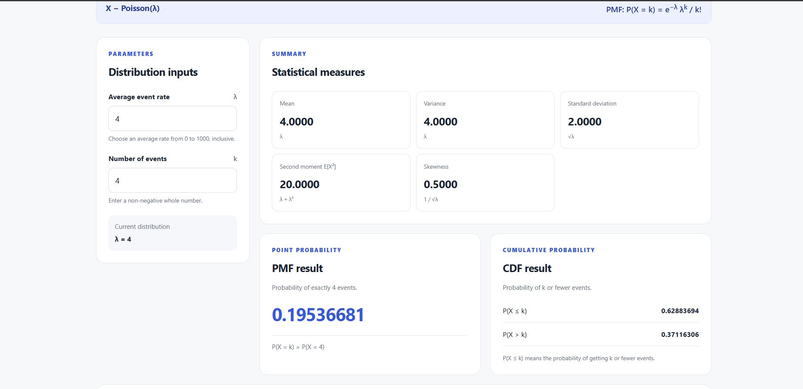
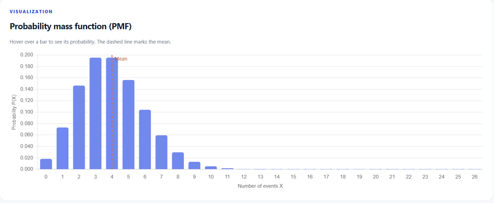
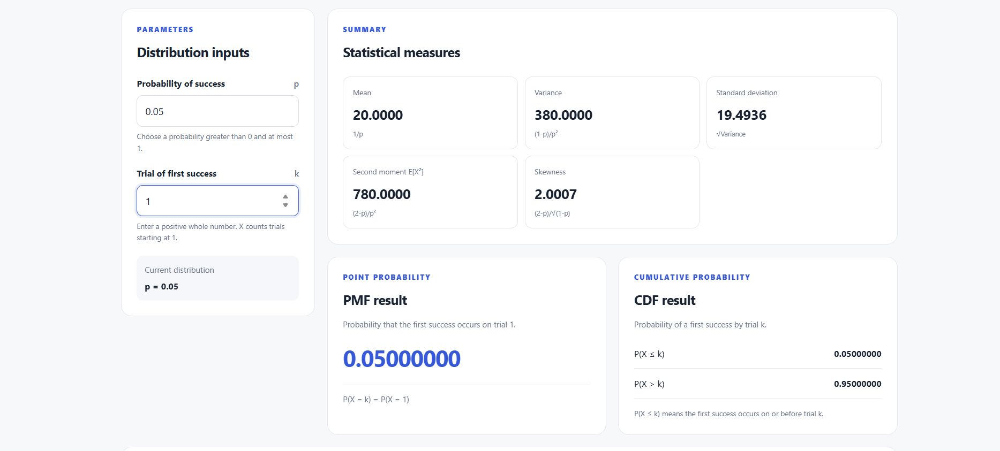
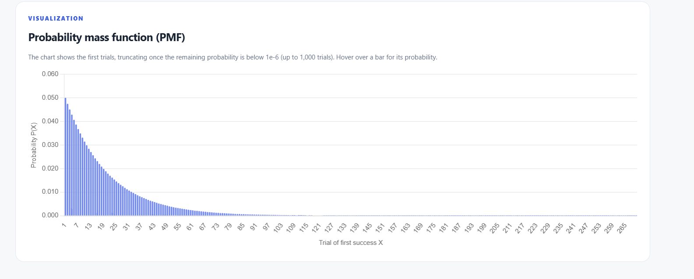

# Discrete Probability Distributions Lab

A simple Flask web application for an undergraduate AIML laboratory, with interactive Binomial, Poisson, and Geometric distribution modules.

## Requirements
- Python 3.10 or newer
- Internet connection to load Chart.js from its CDN in the browser

## Run on Windows (PowerShell)
1. Extract the ZIP file.
2. Open PowerShell in the extracted `discrete-probability-lab` folder.
3. Create and activate a virtual environment:

   ```powershell
   py -m venv .venv
   .\.venv\Scripts\Activate.ps1
   ```

4. Install dependencies:

   ```powershell
   pip install -r requirements.txt
   ```

5. Start the application:

   ```powershell
   python app.py
   ```

6. Open http://127.0.0.1:5000 in your browser.

## Included
- Home page and navigation for Home, Binomial, Poisson, and Geometric
- Binomial inputs (n and p), with defaults 20 and 0.35
- Poisson inputs (rate λ and event count k), with defaults 4 and 4
- Geometric inputs (success probability p and trial of first success k), with defaults 0.35 and 3
- Mean, variance, standard deviation, second moment, and skewness
- PMF and CDF calculators for Binomial, Poisson, and Geometric distributions
- Small probabilities use scientific notation, and near-one CDFs retain their small complementary tail in the display
- Download distribution results and PMF charts as named PDFs (`binomial.pdf`, `poisson.pdf`, or `geometric.pdf`)
- Dynamic PMF bar charts with probability tooltips and a dashed mean reference line
- Input validation and edge-case handling

## Notes
- No database is required.
- For `p = 0` or `p = 1`, the variance is zero and skewness is displayed as not defined.
- For Geometric, `p` must be greater than 0; at `p = 1` the first success is certain on the first trial and skewness is not defined.
- Poisson rate values are limited to 0 through 1000 so the distribution chart remains practical to render.
- Geometric trials count from 1; its success probability must be greater than 0 and at most 1.
- The Geometric chart shows at most 1,000 trials and aims to include all but 1e-6 of the distribution's probability mass.


## OUTPUT RESULT
 In this experiment I understood how Binomial Poisson and Geometric distributions work and how they show up in real situations. Using the defect numbers I figured out the mean variance and standard deviation along with the chances for different results. t. It seems like comparing those theoretical numbers to what really happened made the differences stand out more than I expected.

 the work helped with grasping these distributions and showed programming as a way to handle stats problems without too much trouble. Some parts of the graphs were easy to miss at first. It feels like the observed rate difference might matter more than it looks on paper but maybe that depends on the sample size used..

### Overall result and testing

In my 10 batches, the number of defects was mostly between 0 and 2, and the obeserved average of 1.1 was near the Binomial model's expected average of 1. The measured defect rate of 5.5% is a little above the assumed 5%, but this is only 200 products, so more batches should be checked before deciding if the process has a real quality problem. The graphs helped me see how a higher defect probability shifts the Binomial outcomes and how the Poisson model can estimate counts for a larger group.

I ran the  tests: 23 passed. I also checked the PDF export in the browser; it produced a valid PDF with the distribution name as the file name.

## web application screenshot







